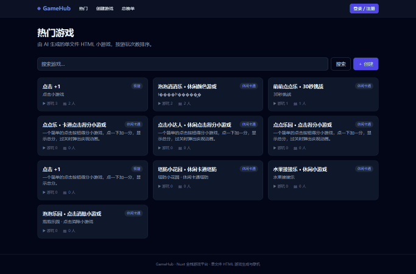
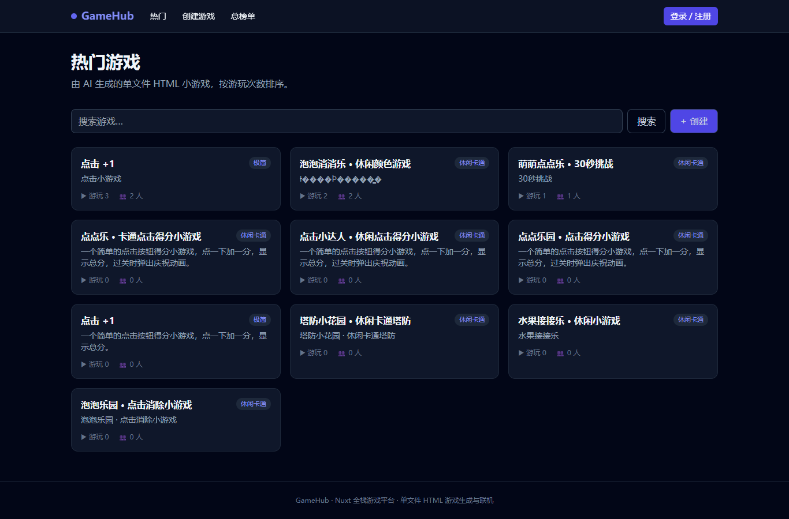
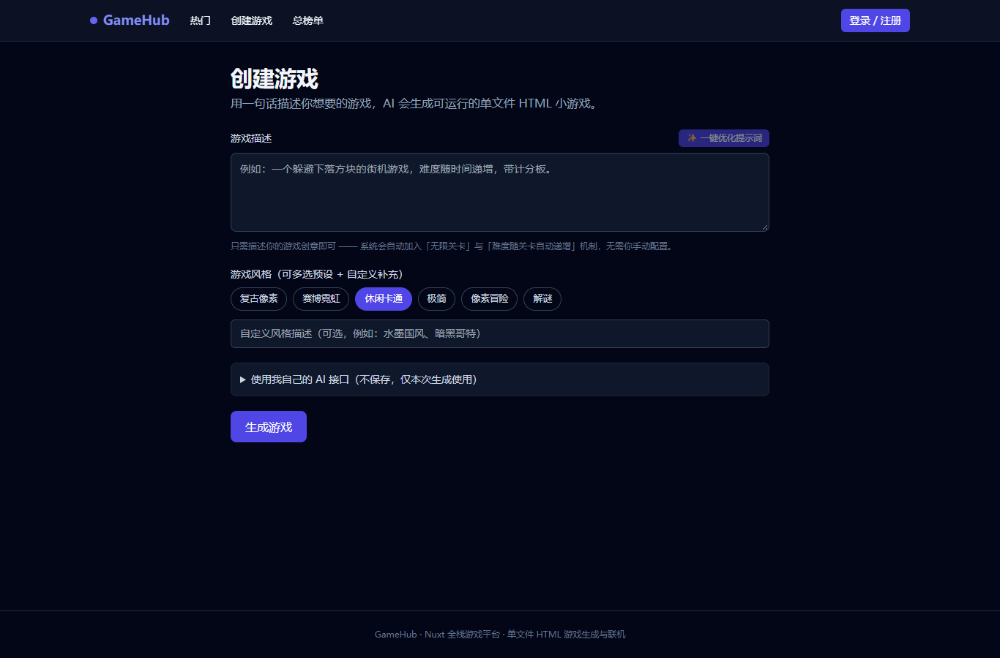
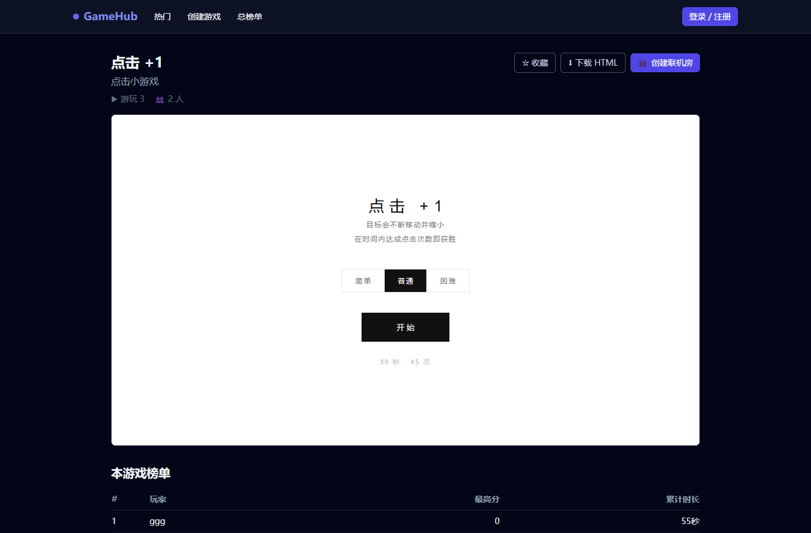
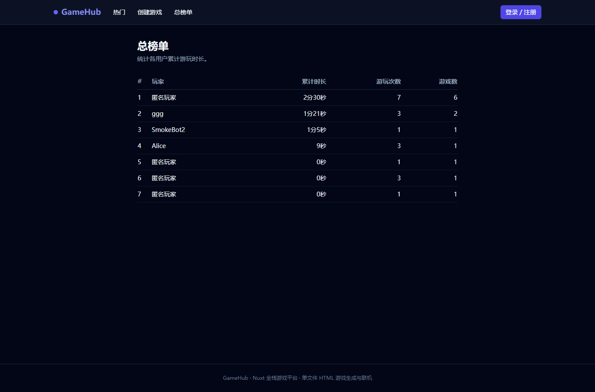
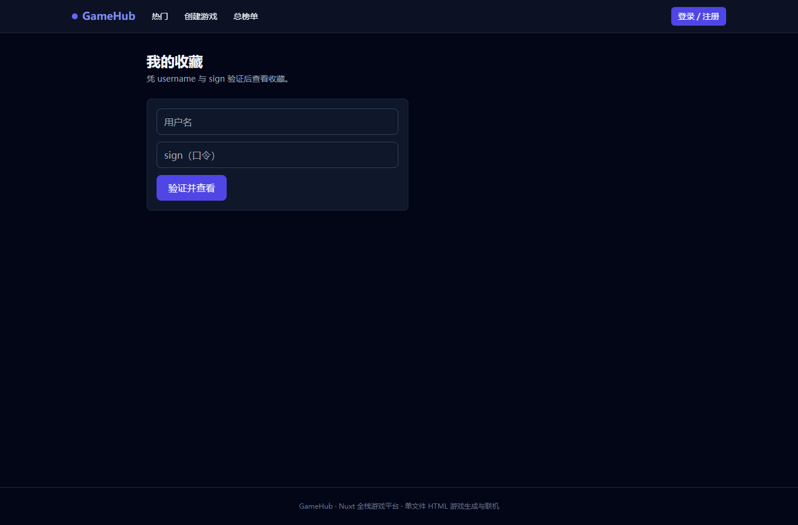

# GameHub 🎮

AI 驱动的**单文件 HTML 小游戏**生成与分享平台。用一句话描述你的游戏创意，AI 即可生成可在浏览器直接运行的单文件 HTML 游戏；平台还提供榜单、收藏、用户系统等完整能力。

> 用户只需构思游戏创意，无需关心技术细节：系统会自动要求生成的游戏支持**无限关卡**，且**难度随关卡由游戏自身逻辑自动递增**。

---

## ✨ 功能特性

- **AI 生成单文件 HTML 游戏**：输入描述 → 流式生成可运行的单文件 HTML 小游戏，可在线试玩与下载。
- **提示词一键优化**：「✨ 一键优化提示词」按钮使用**独立的优化大模型**（与主生成模型解耦），把简短创意扩写成结构化的游戏设计提示词。
- **无限关卡 + 难度自动配置**：生成提示词内置服务端预设（用户不可见），强制要求游戏支持无限关卡、难度按关卡号用公式自动递增。
- **风格选择**：复古像素 / 赛博霓虹 / 休闲卡通 / 极简 / 像素冒险 / 解谜。
- **内容安全检测**：生成前对描述做内容审核。
- **可运行性校验**：自动补齐 `charset` / `viewport`、强制撑满容器布局、禁止外部资源、脚本语法校验，避免乱码与显示不全。
- **榜单**：单游戏榜单 + 总榜（按游玩时长）；游戏通过桥接自动上报分数参与排行。
- **问题举报与自动隐藏**：玩家可在游戏详情页「⚠ 提交问题」举报 bug / 不当内容；同一用户去重计次，**累计达 5 次举报自动隐藏该游戏**（从列表、搜索、收藏、榜单中过滤）。
- **收藏**：用户可收藏游戏（基于 `username + sign` 签名校验，防伪造）。
- **用户系统**：`uuid.v4` 匿名用户，可设置用户名，资料可分享。
- **自带 AI 配置**：用户可临时填入自己的 `baseUrl / apiKey / model`，仅本次生成使用，不落库。

---

## 📸 演示

> 以下截图来自本地运行实例（生产构建，`localhost:3000`）。



### 页面截图

| 首页（热门游戏） | 创建游戏（含「一键优化提示词」） |
| --- | --- |
|  |  |

| 游戏详情（可试玩 / 下载） | 总榜单 |
| --- | --- |
|  |  |

| 我的收藏 |
| --- |
|  |

---

## 🧱 技术栈

- **Nuxt 3**（前后端一体，Nitro 服务端）
- **MongoDB**（`mongodb` 原生驱动，单例连接）
- **OpenAI 兼容 `/v1/chat/completions`** 接口（生成 & 优化均兼容）
- **undici**：生产环境下稳定流式读取 SSE（规避 unenv polyfill 的分块问题）
- **ws**：独立 WebSocket 服务（端口 3001）
- **Tailwind CSS**
- **acorn**：生成 HTML 内脚本语法校验

---

## 🚀 快速开始

### 环境要求

- Node.js ≥ 18
- 一个可访问的 MongoDB（默认 `mongodb://192.168.28.9:27017`，可改）

### 1. 安装依赖

```bash
npm install
```

### 2. 配置环境变量

复制示例文件并填入你自己的配置：

```bash
cp .env.example .env
```

编辑 `.env`（详见下方变量说明）。**切勿把真实 `.env` 提交进仓库。**

### 3. 开发模式

```bash
npm run dev
```

访问 http://localhost:3000

### 4. 生产构建与运行

```bash
npm run build
# 运行时通过环境变量注入（runtimeConfig 私密字段在构建期固化，务必在启动时传入）
MONGODB_URI=mongodb://192.168.28.9:27017 \
AI_API_KEY=你的key \
AI_BASE_URL=https://你的接口/v1 \
AI_MODEL=你的模型 \
OPT_AI_API_KEY=优化模型key \
OPT_AI_BASE_URL=https://优化模型接口/v1 \
OPT_AI_MODEL=优化模型 \
APP_SECRET=任意密钥 \
node .output/server/index.mjs
```

> HTTP 服务监听 **3000**。
> 也可使用 `npm run preview` 预览构建产物。

---

## 🔧 环境变量

| 变量 | 说明 | 默认值 |
| --- | --- | --- |
| `MONGODB_URI` | MongoDB 连接串 | `mongodb://192.168.28.9:27017` |
| `AI_API_KEY` | 生成游戏用的 AI Key | 无 |
| `AI_BASE_URL` | 生成游戏用的 OpenAI 兼容 Base URL | `https://api.openai.com/v1` |
| `AI_MODEL` | 生成游戏用的模型名 | `gpt-4o-mini` |
| `AI_TIMEOUT_MS` | 生成超时（毫秒） | `300000` |
| `OPT_AI_API_KEY` | **优化提示词**专用模型 Key | 回退到 `AI_API_KEY` |
| `OPT_AI_BASE_URL` | 优化模型 Base URL | 回退到 `AI_BASE_URL` |
| `OPT_AI_MODEL` | 优化模型名 | 回退到 `AI_MODEL` |
| `OPT_AI_TIMEOUT_MS` | 优化超时（毫秒） | `120000` |
| `APP_SECRET` | 用于 `sign` 哈希的盐/密钥 | `gamehub-default-secret` |

> 优化模型与主生成模型相互独立：想用不同模型时，只需配置 `OPT_AI_*` 四项即可，互不干扰。
> 用户在前端「使用我自己的 AI 接口」中临时填写的配置仅作用于当次生成，不会保存。

---

## 🔌 主要接口

| 方法 & 路径 | 说明 |
| --- | --- |
| `POST /api/games` | **SSE 流式**生成游戏（事件：`status` / `token` / `done` / `error`） |
| `GET  /api/games` | 游戏列表（按热度/时间） |
| `GET  /api/games/:id` | 游戏详情 |
| `GET  /api/games/:id/download` | 下载单文件 HTML |
| `POST /api/optimize-prompt` | 优化提示词（独立模型，返回 `{ text }`） |
| `POST /api/games/:id/play` | 记录游玩（热度/时长/分数） |
| `POST /api/games/:id/report` | 举报游戏问题（去重计次，达阈值自动隐藏） |
| `POST /api/games/:id/favorite` | 收藏 / 取消收藏（签名校验） |
| `GET  /api/games/:id/leaderboard` | 单游戏榜单 |
| `GET  /api/leaderboard/total` | 总榜（按游玩时长） |
| `POST /api/users/verify` | 用户签名校验 |
| `GET  /api/users/:id` | 用户资料 |
| `GET  /api/favorites/:username` | 某用户的收藏列表 |

---

## 📁 目录结构

```
gamehub/
├─ server/
│  ├─ api/                 # API 路由（games / users / favorites / leaderboard / optimize-prompt）
│  └─ utils/               # ai / moderation / validateHtml / mongo / auth
├─ pages/                  # 页面：create / games/[id] / leaderboard / favorites / users/[id] / index
├─ components/             # GameFrame / GameCard / FavoriteButton / StylePicker
├─ composables/            # useUser
├─ assets/css/main.css     # Tailwind 入口
├─ scripts/                # seed / smoke 测试脚本
├─ nuxt.config.ts
└─ .env.example
```

---

## 🧪 测试脚本

```bash
node scripts/smoke.mjs          # 用户/收藏/榜单 流程测试
node scripts/test_normalize.mjs # HTML 规范化（charset/viewport）单测
node scripts/seed.mjs           # 插入示例游戏
```

---

## ⚠️ 注意事项

- **密钥安全**：真实 `.env` 已被 `.gitignore` 忽略，请勿提交。仓库仅保留 `.env.example` 占位符。
- **生产环境变量**：Nitro 的 `runtimeConfig` 私密字段在**构建期固化**，因此生产运行 `node .output/server/index.mjs` 时务必通过环境变量（或在命令行内联）注入 AI 等配置。
- **无限关卡 / 难度递增**：由生成提示词的服务端预设保证，用户无需、也无法手动配置。
- **生成的游戏为纯前端单文件 HTML**，运行在隔离的 iframe 中，不依赖平台后端。

---

## 📄 License

MIT
